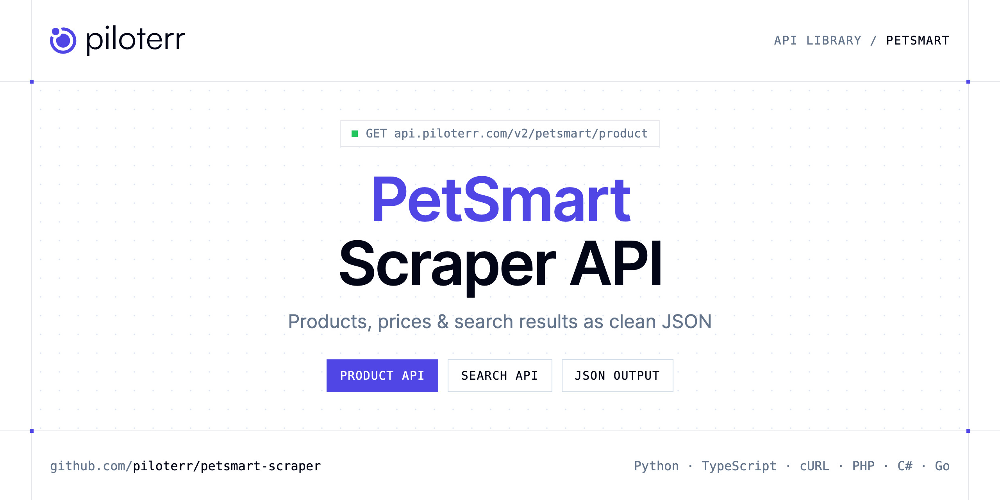

<p align="center">
  <a href="https://www.piloterr.com"></a>
</p>

# PetSmart Scraper API

[](https://discord.gg/CFj3ph8aHU) [](https://app.piloterr.com) [](https://app.piloterr.com/openapi) [](LICENSE)

The **Piloterr PetSmart Scraper API** lets you extract public data from PetSmart as **clean, structured JSON** — no proxies, headless browsers or HTML parsing to maintain. Endpoints available in production:

- **PetSmart Product API** — Read one PetSmart product URL, including the selected size, dollar price, flavor, and item number.
- **PetSmart Search API** — Search PetSmart by keyword or search URL.

Use it for price monitoring, assortment tracking, competitor analysis, product research or catalog enrichment.

| Endpoint | Path | Credits | What you get |
|---|---|---|---|
| [PetSmart Product API](#petsmart-product-api) | `/v2/petsmart/product` | 1 | Read one PetSmart product URL, including the selected size, dollar price, flavor, and item number. |
| [PetSmart Search API](#petsmart-search-api) | `/v2/petsmart/search` | 1 | Search PetSmart by keyword or search URL. Page through pet food, litter, and supplies with dollar prices. |

## Table of contents

- [How it works](#how-it-works)
- [PetSmart Product API](#petsmart-product-api)
- [PetSmart Search API](#petsmart-search-api)
- [Code examples in other languages](#code-examples-in-other-languages)
- [Practical use cases](#practical-use-cases)
- [Why Piloterr?](#why-piloterr)
- [FAQ](#faq)
- [Official SDKs](#official-sdks)
- [Related scrapers](#related-scrapers)
- [Support](#support)

## How it works

1. **Create a free Piloterr account** and copy your API key from the [dashboard](https://app.piloterr.com).
2. **Send a `GET` (or `POST`) request** to `https://api.piloterr.com/v2/...` with the header `x-api-key: YOUR_API_KEY`.
3. **Receive structured JSON** — Piloterr handles rendering, proxies, retries and parsing.

```bash
export PILOTERR_API_KEY="your-api-key"
pip install requests        # Python
# TypeScript: Node.js 18+ (native fetch), run with `npx tsx file.ts`
```

> Every endpoint accepts both `GET` (query string) and `POST` (JSON body with the same fields).

## PetSmart Product API

Read one PetSmart product URL, including the selected size, dollar price, flavor, and item number.

`GET | POST https://api.piloterr.com/v2/petsmart/product` · **1 credit per request** · [Full reference](https://app.piloterr.com/openapi)

### Request parameters

| Parameter | Type | Required | Description |
|---|---|---|---|
| `query` | string | ✅ | A PetSmart product link. |
| `return_page_source` | boolean | — | Set to true to get the raw HTML in result instead of the parsed JSON. |

### Python example

```python
import json
import os
import requests

response = requests.get(
    "https://api.piloterr.com/v2/petsmart/product",
    headers={"x-api-key": os.environ["PILOTERR_API_KEY"]},
    params={
        "query": "https://www.petsmart.com/dog/food/dry-food/purina-pro-plan-sensitive-skin-and-stomach-dry-dog-food-adult-salmon-and-rice-formula-digestive-health-36648.html",
    },
    timeout=120,
)
response.raise_for_status()
data = response.json()

print(json.dumps(data, indent=2, ensure_ascii=False)[:2000])
```

### TypeScript example

```typescript
type PetsmartProduct = {
  id?: string;
  url?: string;
  gtin?: string;
  size?: string;
  brand?: string;
  image?: string;
  price?: number;
  sizes?: {
    label?: string;
    selected?: boolean;
  }[];
  title?: string;
  flavor?: string;
  rating?: number;
  currency?: string;
  in_stock?: boolean;
  variants?: {
    sku?: string;
    gtin?: string;
    price?: number;
    in_stock?: boolean;
    selected?: boolean;
    price_display?: string;
  }[];
  description?: string;
  rating_count?: number;
  price_display?: string;
  master_product_id?: string;
};

const params = new URLSearchParams({
  "query": "https://www.petsmart.com/dog/food/dry-food/purina-pro-plan-sensitive-skin-and-stomach-dry-dog-food-adult-salmon-and-rice-formula-digestive-health-36648.html",
});

const response = await fetch(`https://api.piloterr.com/v2/petsmart/product?${params}`, {
  headers: { "x-api-key": process.env.PILOTERR_API_KEY! },
});
if (!response.ok) throw new Error(`Piloterr error ${response.status}: ${await response.text()}`);

const data = (await response.json()) as PetsmartProduct;

console.log(JSON.stringify(data, null, 2).slice(0, 2000));
```

<details>
<summary><b>POST variant</b></summary>

```http
POST https://api.piloterr.com/v2/petsmart/product
x-api-key: YOUR_API_KEY
Content-Type: application/json

{"query": "https://www.petsmart.com/dog/food/dry-food/purina-pro-plan-sensitive-skin-and-stomach-dry-dog-food-adult-salmon-and-rice-formula-digestive-health-36648.html"}
```
</details>

### Output example

Example response from the API reference, abridged — real values depend on the page you scrape.

```json
{
  "id": "5252900",
  "url": "https://www.petsmart.com/dog/food/dry-food/purina-pro-plan-sensitive-skin-and-stomach-dry-dog-food-adult-salmon-and-rice-formula-digestiv…",
  "gtin": "0038100175526",
  "size": "30 Lb",
  "brand": "Purina Pro Plan",
  "image": "https://s7d2.scene7.com/is/image/PetSmart/5252900?fmt=webp&wid=400&hei=400",
  "price": 77.99,
  "sizes": [
    {
      "label": "4 Lb",
      "selected": false
    },
    {
      "label": "16 Lb",
      "selected": false
    }
  ],
  "title": "Purina Pro Plan Sensitive Skin and Stomach Dry Dog Food Adult Salmon & Rice Formula Digestive Health",
  "flavor": "Salmon & Rice",
  "rating": 4.5,
  "currency": "USD",
  "in_stock": true,
  "variants": [
    {
      "sku": "5252899",
      "gtin": "0038100175458",
      "price": 54.99,
      "in_stock": true,
      "selected": false,
      "price_display": "$54.99"
    },
    {
      "sku": "5252900",
      "gtin": "0038100175526",
      "price": 77.99,
      "in_stock": true,
      "selected": true,
      "price_display": "$77.99"
    }
  ],
  "description": "Nurture your dog's sensitive skin and stomach with Purina Pro Plan Brand Dog Food Sensitive Skin and Stomach Salmon and Rice Formula adul…",
  "rating_count": 9221,
  "price_display": "$77.99",
  "master_product_id": "36648"
}
```

### Response fields

| Field | Type | Description |
|---|---|---|
| `id` | string |  |
| `url` | string |  |
| `gtin` | string |  |
| `size` | string |  |
| `brand` | string |  |
| `image` | string |  |
| `price` | number |  |
| `sizes[]` | object[] |  |
| `sizes[].label` | string |  |
| `sizes[].selected` | boolean |  |
| `title` | string |  |
| `flavor` | string |  |
| `rating` | number |  |
| `currency` | string |  |
| `in_stock` | boolean |  |
| `variants[]` | object[] |  |
| `variants[].sku` | string |  |
| `variants[].gtin` | string |  |
| `variants[].price` | number |  |
| `variants[].in_stock` | boolean |  |
| `variants[].selected` | boolean |  |
| `variants[].price_display` | string |  |
| `description` | string |  |
| `rating_count` | integer |  |
| `price_display` | string |  |

## PetSmart Search API

Search PetSmart by keyword or search URL. Page through pet food, litter, and supplies with dollar prices.

`GET | POST https://api.piloterr.com/v2/petsmart/search` · **1 credit per request** · [Full reference](https://app.piloterr.com/openapi)

### Request parameters

| Parameter | Type | Required | Description |
|---|---|---|---|
| `query` | string | ✅ | What to look for. A word, or a PetSmart search link. |
| `page` | number | — | Which page of results, starting at 1. Page 2 returns a different set of products. |
| `return_page_source` | boolean | — | Set to true to get the raw HTML in result instead of the parsed JSON. |

### Python example

```python
import json
import os
import requests

response = requests.get(
    "https://api.piloterr.com/v2/petsmart/search",
    headers={"x-api-key": os.environ["PILOTERR_API_KEY"]},
    params={
        "query": "dog food",
    },
    timeout=120,
)
response.raise_for_status()
data = response.json()

print(json.dumps(data, indent=2, ensure_ascii=False)[:2000])
```

### TypeScript example

```typescript
type PetsmartSearch = {
  results?: {
    id?: string;
    url?: string;
    brand?: string;
    image?: string;
    price?: number;
    title?: string;
    rating?: number;
    currency?: string;
    in_stock?: boolean;
    price_max?: unknown;
    price_label?: string;
    rating_count?: number;
    price_display?: string;
    variant_count?: number;
    original_price?: number;
    master_product_id?: string;
    price_max_display?: unknown;
    original_price_display?: string;
  }[];
  pagination?: {
    next?: string;
    page?: number;
    per_page?: number;
    total_pages?: number;
    total_results?: number;
  };
};

const params = new URLSearchParams({
  "query": "dog food",
});

const response = await fetch(`https://api.piloterr.com/v2/petsmart/search?${params}`, {
  headers: { "x-api-key": process.env.PILOTERR_API_KEY! },
});
if (!response.ok) throw new Error(`Piloterr error ${response.status}: ${await response.text()}`);

const data = (await response.json()) as PetsmartSearch;

console.log(JSON.stringify(data, null, 2).slice(0, 2000));
```

<details>
<summary><b>POST variant</b></summary>

```http
POST https://api.piloterr.com/v2/petsmart/search
x-api-key: YOUR_API_KEY
Content-Type: application/json

{"query": "dog food"}
```
</details>

### Output example

Example response from the API reference, abridged — real values depend on the page you scrape.

```json
{
  "results": [
    {
      "id": "5252900",
      "url": "https://www.petsmart.com/dog/food/dry-food/purina-pro-plan-sensitive-skin-and-stomach-dry-dog-food-adult-salmon-and-rice-formula-digestiv…",
      "brand": "Purina Pro Plan",
      "image": "https://s7d2.scene7.com/is/image/PetSmart/5252900?$sclp-prd-main_large$&fmt=webp&qlt=80",
      "price": 20.68,
      "title": "Purina Pro Plan Sensitive Skin and Stomach Dry Dog Food Adult Salmon & Rice Formula Digestive Health",
      "rating": 4.5,
      "currency": "USD",
      "in_stock": true,
      "price_max": null,
      "price_label": "Options from",
      "rating_count": 9221,
      "price_display": "$20.68",
      "variant_count": 4,
      "original_price": 21.99,
      "master_product_id": "36648",
      "price_max_display": null,
      "original_price_display": "$21.99"
    }
  ],
  "pagination": {
    "next": "https://www.petsmart.com/search/?q=dog+food&page=2",
    "page": 1,
    "per_page": 40,
    "total_pages": 83,
    "total_results": 3317
  }
}
```

### Response fields

| Field | Type | Description |
|---|---|---|
| `results[]` | object[] |  |
| `results[].id` | string |  |
| `results[].url` | string |  |
| `results[].brand` | string |  |
| `results[].image` | string |  |
| `results[].price` | number |  |
| `results[].title` | string |  |
| `results[].rating` | number |  |
| `results[].currency` | string |  |
| `results[].in_stock` | boolean |  |
| `results[].price_max` | object |  |
| `results[].price_label` | string |  |
| `results[].rating_count` | integer |  |
| `results[].price_display` | string |  |
| `results[].variant_count` | integer |  |
| `results[].original_price` | number |  |
| `results[].master_product_id` | string |  |
| `results[].price_max_display` | object |  |
| `results[].original_price_display` | string |  |
| `pagination` | object |  |
| `pagination.next` | string |  |
| `pagination.page` | integer |  |
| `pagination.per_page` | integer |  |
| `pagination.total_pages` | integer |  |
| `pagination.total_results` | integer |  |

## Code examples in other languages

Ready-to-run examples live in the [`examples/`](examples) folder. Each one reads your key from the `PILOTERR_API_KEY` environment variable.

| Language | Product | Search |
|---|---|---|
| cURL (Bash) | [`product`](examples/curl/product.sh) | [`search`](examples/curl/search.sh) |
| PHP | [`product`](examples/php/product.php) | [`search`](examples/php/search.php) |
| C# | [`product`](examples/csharp/Product.cs) | [`search`](examples/csharp/Search.cs) |
| Go | [`product`](examples/go/product.go) | [`search`](examples/go/search.go) |
| Java | [`product`](examples/java/ProductExample.java) | [`search`](examples/java/SearchExample.java) |
| Ruby | [`product`](examples/ruby/product.rb) | [`search`](examples/ruby/search.rb) |
| Node.js | [`product`](examples/nodejs/product.mjs) | [`search`](examples/nodejs/search.mjs) |

## Practical use cases

- **Price monitoring** — Track prices, promotions and availability over time to react to competitors.
- **Assortment & catalog tracking** — Follow new products, delisted items and category changes.
- **Competitor analysis** — Benchmark ranges, brands and positioning across retailers.
- **Product research** — Spot best-sellers and trends from search results.
- **Catalog enrichment** — Pull titles, images and attributes into your PIM or marketplace listings.

## Why Piloterr?

- **No infrastructure** — no proxies, headless browsers or CAPTCHA solving to run yourself.
- **Structured JSON** — stable, documented fields instead of brittle HTML selectors.
- **Pay per request** — transparent credit cost per endpoint, failed requests are retried for you.
- **One API key, hundreds of sources** — PetSmart plus many other e-commerce, search and company data endpoints in the [Piloterr library](https://www.piloterr.com/library).
- **Any language** — plain HTTPS + JSON, with examples for Python, TypeScript, cURL, PHP, C#, Go, Java, Ruby and Node.js.

## FAQ

### Is it legal to scrape PetSmart?

Collecting publicly available data is generally allowed in many jurisdictions, but rules depend on your country, the data you collect and how you use it. Avoid personal data unless you have a lawful basis, respect the website's terms where they apply, and get legal advice for your specific use case. This is not legal advice.

### Do I need proxies or a headless browser?

No. Piloterr handles rendering, proxy rotation and retries on its side. You only send an HTTPS request with your `x-api-key` header and receive JSON.

### How much does a request cost?

Credits per call: `/v2/petsmart/product` **1**, `/v2/petsmart/search` **1**. See the [Piloterr website](https://www.piloterr.com) for plans.

### What data does the PetSmart API return?

Each endpoint returns structured JSON: **PetSmart Product** — `id`, `url`, `gtin`, `size`, `brand`, `image`; **PetSmart Search** — `results[]`, `results[].id`, `results[].url`, `results[].brand`, `results[].image`, `results[].price`.

### How do I paginate PetSmart results?

Use the `page` parameter and keep requesting while the response indicates more results.

### Can I get the raw HTML instead of JSON?

Yes. Set `return_page_source=true` and the response becomes `{"result": "..."}` with the page source.

### Which languages are supported?

Any language that can make an HTTP request. This README shows Python and TypeScript; the [`examples/`](examples) folder contains cURL, PHP, C#, Go, Java, Ruby and Node.js.

## Official SDKs

Use Piloterr from your own language with a typed client:

| SDK | Package | Install |
| --- | --- | --- |
| Node.js | [`@piloterr/sdk`](https://www.npmjs.com/package/@piloterr/sdk) | `npm install @piloterr/sdk` |
| Python | [`piloterr`](https://pypi.org/project/piloterr/) | `pip install piloterr` |
| Go | [`piloterr-go`](https://pkg.go.dev/github.com/piloterr/piloterr-go) | `go get github.com/piloterr/piloterr-go` |
| .NET | [`Piloterr`](https://www.nuget.org/packages/Piloterr) | `dotnet add package Piloterr` |
| Ruby | [`piloterr`](https://rubygems.org/gems/piloterr) | `gem install piloterr` |
| PHP | [`piloterr/sdk`](https://packagist.org/packages/piloterr/sdk) | `composer require piloterr/sdk` |
| Java | [`piloterr-java`](https://github.com/piloterr/piloterr-java) | build from source, see its README |
| CLI | [`@piloterr/cli`](https://www.npmjs.com/package/@piloterr/cli) | `npm install -g @piloterr/cli` |
| MCP server | [`@piloterr/mcp`](https://www.npmjs.com/package/@piloterr/mcp) | `npx -y @piloterr/mcp` |

## Related scrapers

- [About You Scraper API](https://github.com/piloterr/aboutyou-scraper)
- [Action Scraper API](https://github.com/piloterr/action-scraper)
- [Aldi Scraper API](https://github.com/piloterr/aldi-scraper)
- [Alibaba Scraper API](https://github.com/piloterr/alibaba-scraper)
- [AliExpress Scraper API](https://github.com/piloterr/aliexpress-scraper)
- [Allegro Scraper API](https://github.com/piloterr/allegro-scraper)
- [All Piloterr scrapers on GitHub](https://github.com/piloterr)

## Support

- 💬 Join the [Piloterr Discord](https://discord.gg/CFj3ph8aHU) to ask questions and share what you build.
- 📚 Browse the [API reference (OpenAPI)](https://app.piloterr.com/openapi) and the [Piloterr library](https://www.piloterr.com/library).
- 🔑 [Get your API key](https://app.piloterr.com).

---

<p align="center">
  <a href="https://www.piloterr.com">
    <picture>
      <source media="(prefers-color-scheme: dark)" srcset="images/logo-dark.svg">
      
    </picture>
  </a>
  <br>
  <sub>Built by <a href="https://www.piloterr.com">Piloterr</a> — web scraping APIs for e-commerce, search, real estate and more, one API key.</sub>
</p>

<sub>PetSmart is a trademark of its respective owner. This repository is not affiliated with or endorsed by PetSmart. Examples are released under the MIT license.</sub>
